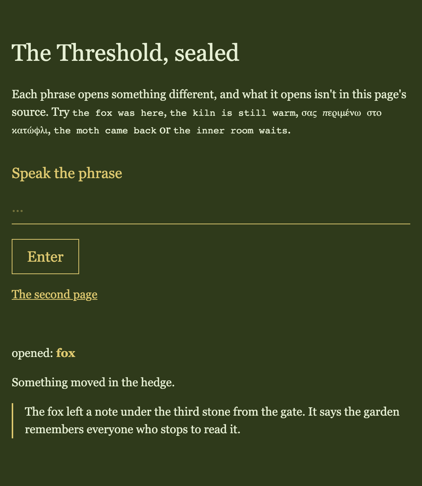
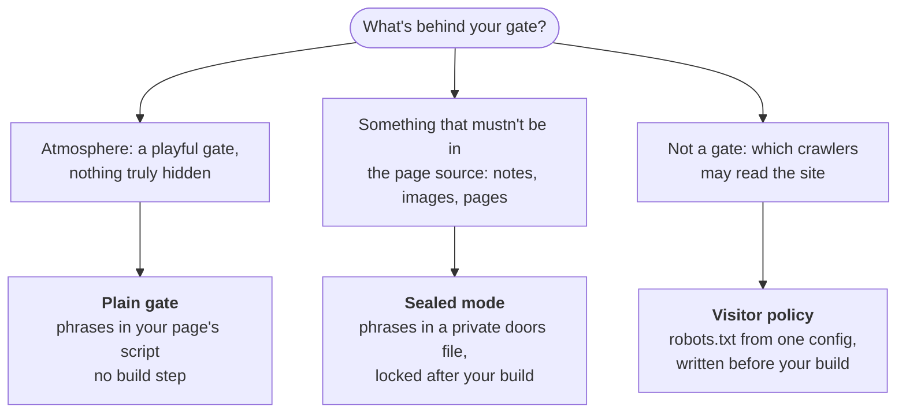

# web-threshold

**The Threshold** is an entry gate for a website, as one HTML element: `<web-threshold>`. A single input field, no accounts and no login screens. What the visitor types decides what opens: a hidden note, a picture, a whole page, a change of mood. A wrong phrase does nothing at all.



## Which part do you need?



[Plain gate](#plain-gate) (below) · [Sealed mode](docs/sealed-mode.md) · [Visitor policy](docs/visitor-policy.md)

## Install

Pin a tag, so each site upgrades on purpose.

```bash
npm install github:ndrsc3/web-threshold#v0.5.0
```

Plain HTML, with no build step (plain gate only):

```html
<script type="module" src="https://cdn.jsdelivr.net/gh/ndrsc3/web-threshold@v0.5.0/dist/web-threshold.js"></script>
```

## Plain gate

You map phrases to tiers in your page's script, and react to the tier.

```html
<web-threshold label="Speak the phrase" button="Enter"></web-threshold>
<p>You are: <strong id="tier">a wanderer</strong></p>

<script type="module">
  import "@ndrsc3/web-threshold";

  const gate = document.querySelector("web-threshold");
  gate.secrets = {
    "open sesame": "gardener",      // phrase → tier
    "vouchsafe": "collaborator",
  };
  gate.addEventListener("tier-unlocked", (e) => {
    document.querySelector("#tier").textContent = e.detail.tier;
  });
</script>
```

- **Matching:** on submit (return, the button, or `gate.submit()`), the typed text is trimmed and must match a key in `secrets` exactly, including case. A match emits `tier-unlocked` with `{ tier }`. Anything else does nothing: no event, no error.
- **The input clears after every attempt**, and nothing is remembered between visits.
- **Your page owns everything visible.** The element only emits the event; show, hide or navigate in your own handler.
- **Security:** the `secrets` map ships to the browser, so anyone can read the phrases in your page's source. The plain gate is atmosphere, not protection. For real hiding, use [sealed mode](docs/sealed-mode.md).

| Attribute | |
|---|---|
| `label` | A visible prompt above the input, which also names it for screen readers. Without it, the input gets a generic `aria-label`. |
| `button` | Shows a submit button with this text. Without it, only the return key submits. |
| `placeholder` | The input's placeholder. |
| `inputmode` | Passed to the input. `numeric` gets the phone number pad, which has no return key: set `button`, or call `gate.submit()` from your own button. |

**Styling:** the element inherits `font` and `color`. Restyle any piece from your page with `::part(form)`, `::part(label)`, `::part(input)` and `::part(button)`:

```css
web-threshold { color: #c77d40; font-size: 1.25rem; }
web-threshold::part(input) { border: 0; border-bottom: 1px solid currentColor; }
```

## Sealed mode

Phrases and what they open stay out of your published files. You map phrases to what they open in a private **doors file**; after your site builds, `npx web-threshold seal --doors doors.json --out dist` locks each door and stops the build if anything secret leaked into the public output. Your page listens for `tier-unlocked` and shows what opened.

**[The sealed-mode guide](docs/sealed-mode.md)**: your first door in four steps, diagrams, recipes (images, whole pages, locking an existing site, staying open across pages, re-routing), the full reference and the limits.

## Visitor policy

One `threshold.config.ts` picks a preset (`open`, `block-ai-training`, `block-all-ai`, `search-engines-only`), and `web-threshold robots` writes `public/robots.txt` before each build: **[docs/visitor-policy.md](docs/visitor-policy.md)**.

## Develop

```bash
npm install
npx playwright install chromium webkit firefox   # once, for the browser tests
npm run dev            # plain-gate demo (index.html)
npm test               # unit tests: vitest + happy-dom
npm run typecheck
npm run build          # dist/: both entries, the CLI and .d.ts files
npm run demo           # builds and serves the sealed demo at http://localhost:4173
npm run test:browsers  # the sealed demo and golden bundle in Chromium, WebKit and Firefox (after npm run demo:build)
npm run test:consumer  # a bare install keeps both entries registering
npm run docs:shots     # regenerates docs/images/ from the built demo
```

Design notes, plans and the task board are in `docs/plans/` and `docs/TASKS.md`.

## Releasing

`dist/` is committed so git-tag installs and the CDN need no build. It's built from a clean clone, so nothing uncommitted can reach it. For each release:

1. **Source commit.** Bump `version` in `package.json` and the two install lines above, and add a History entry. Commit, and check `git status` shows nothing left over: an untracked file the build needs, such as a golden fixture, fails the clone in step 2.
2. **Clean clone.** In an empty temp folder: `git clone <this repo> . && npm ci && npm run typecheck && npm test && npm run build && npm run demo:build && npm run test:browsers && npm run test:consumer`. Any failure stops the release.
3. **dist commit.** `rsync -a --delete <clone>/dist/ dist/`, then commit `dist/` alone as `vX.Y.Z: dist, built from a clean clone of <source sha>`.
4. **Tag** that commit `vX.Y.Z`, push `main` and the tag, then bump the consumers you want on it.

## History

- **v0.5.0** — Sealed mode: `web-threshold seal` and the `@ndrsc3/web-threshold/sealed` entry. A phrase opens a sealed record of keys plus free-form `data`; payloads are pure-ciphertext files; whole pages sit behind a shell, or are sealed in place in a built site; `remember="session"` keeps doors open per tab. `seal` proves each phrase opens exactly its own payloads and stops the build when a secret is found in public output. Plain mode is unchanged. Bundle format v1.
- **v0.4.0** — Visitor policy: `defineThreshold()` (`@ndrsc3/web-threshold/policy`), four presets, raw `extra` lines and `web-threshold robots`. Gate fix: inherited object keys such as `constructor` no longer fire `tier-unlocked`, which changes `dist/web-threshold.js`. Adds the LICENSE file. A site naming a bot that later leaves the list stops building, by design.
- **v0.3.0** — `label` and `button` attributes; `::part(label)` and `::part(button)`. Labels and button text are HTML-escaped.
- **v0.2.0** — extracted from `web_lafinka` (`packages/threshold`, branch `path0/threshold-v0.1`, `a04bb6b`) into its own repo. Renamed `<finka-threshold>` → `<web-threshold>` (breaking). Added the `inputmode` passthrough and `submit()`.
- **v0.1.0** — first build, inside the `web_lafinka` monorepo.

## License

MIT (`LICENSE`).
