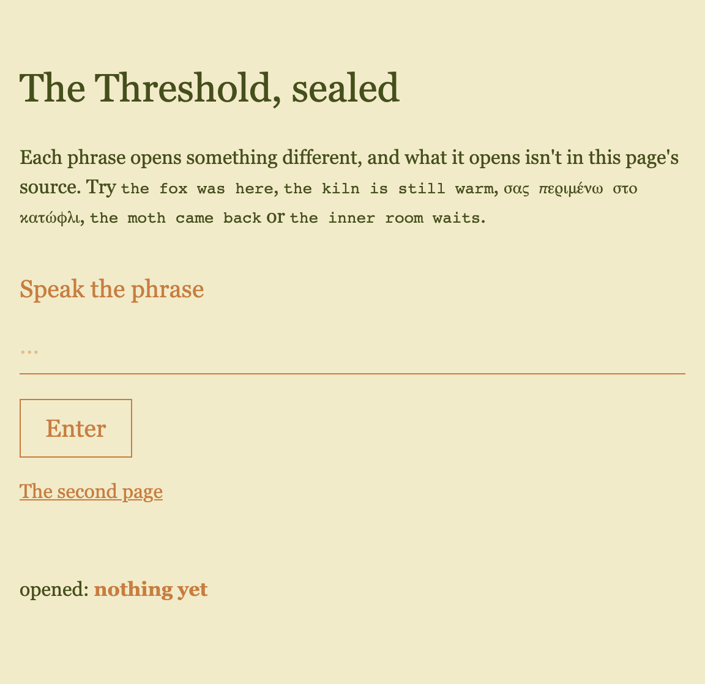
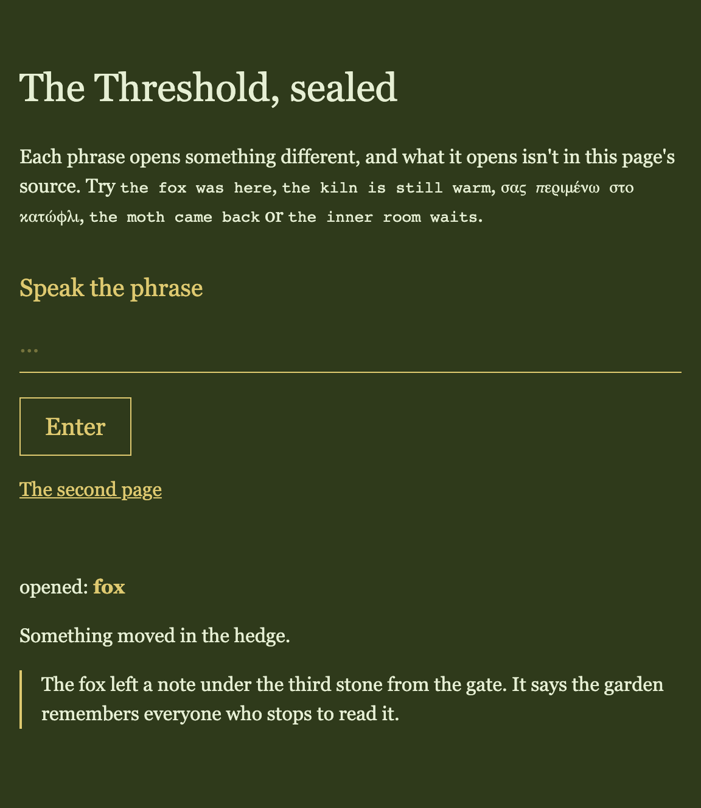
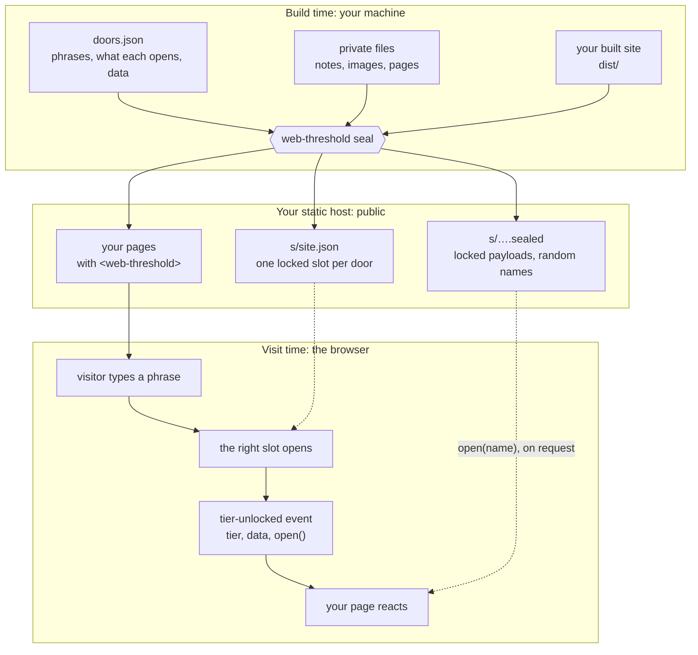
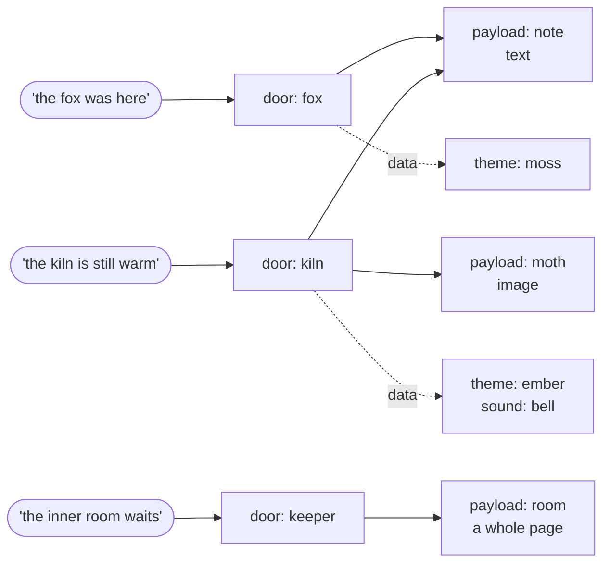
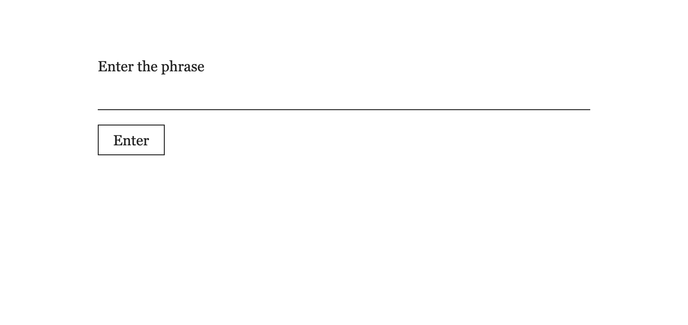
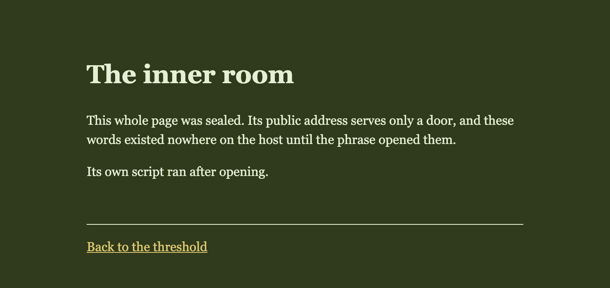
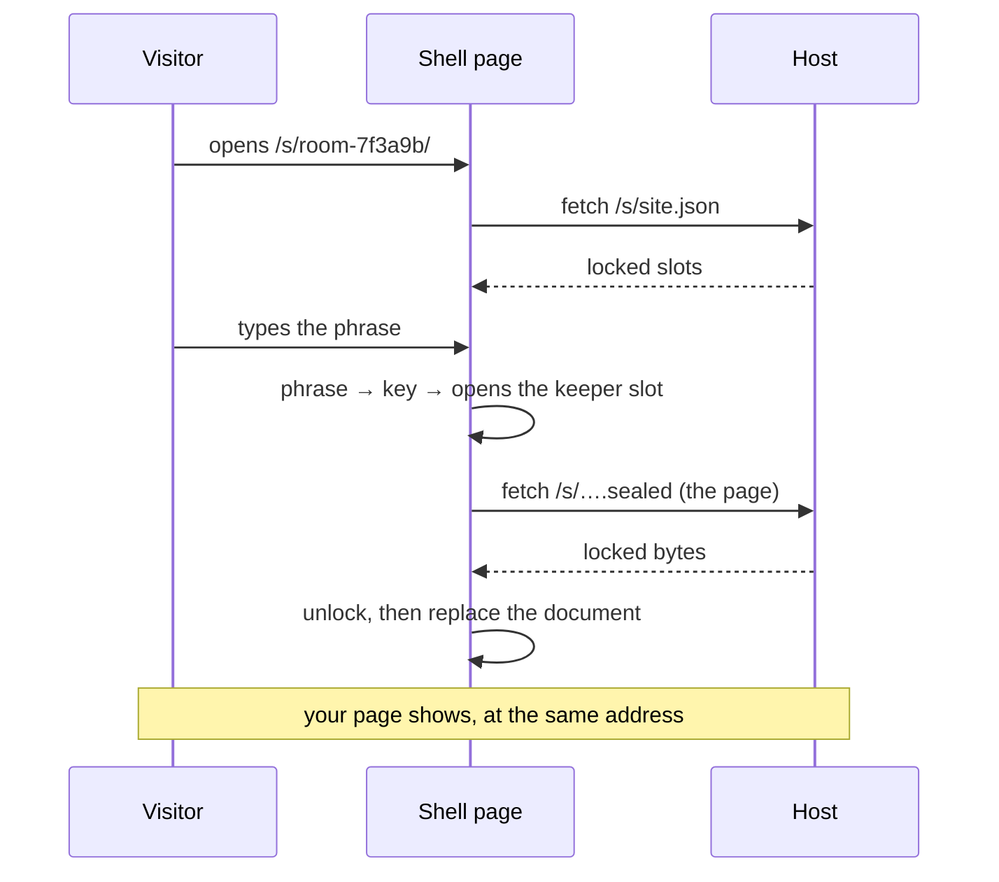

# Sealed mode

A visitor types a phrase, and what it opens was never readable on your host: not in the page source, not in a file you can browse to. Each phrase is a **door**. A door can reveal text, show an image, open a whole page, or hand your page any data you like, such as a theme or a place to go next. New in v0.5. Back to the [README](../README.md).

<table>
<tr>
<td></td>
<td></td>
</tr>
<tr>
<td>Before: the page knows nothing about the phrases.</td>
<td>After <code>the fox was here</code>: the door's data switched the theme, and its sealed note opened.</td>
</tr>
</table>

## How it works

Your phrases exist only on your machine, at build time. `seal` locks each door with a key made from its phrase and puts what the door opens inside its locked slot. Before writing anything, it proves every phrase opens exactly what you declared, and stops if any secret leaked into your public files. In the browser, the typed phrase becomes a key, the matching slot opens, and the element emits an event. It never changes your page itself: your own code decides what to show.



## Your first door

**1. Install** the package, as in the [README](../README.md#install). The element and the `seal` command come together.

**2. Write a doors file** outside your build folder, and add it and `private/` to `.gitignore`: it holds your phrases, and `seal` refuses one that git tracks. Paths in `from` are relative to the doors file.

```json
{
  "payloads": { "note": { "from": "private/note.txt", "type": "text/plain" } },
  "doors": [
    { "tier": "fox", "phrase": "the fox was here", "open": ["note"], "data": { "theme": "moss" } }
  ]
}
```

**3. Put the gate on a page, and react:**

```html
<web-threshold sealed="/s/site.json" button="Enter"></web-threshold>
<p id="note"></p>

<script type="module">
  import "@ndrsc3/web-threshold/sealed";

  const gate = document.querySelector("web-threshold");
  gate.addEventListener("tier-unlocked", async ({ detail }) => {
    document.documentElement.dataset.theme = detail.data?.theme;
    if (detail.names.includes("note")) {
      document.querySelector("#note").textContent = await (await detail.open("note")).text();
    }
  });
</script>
```

**4. Build, then seal** the fresh output, every time:

```json
"scripts": { "build": "vite build", "postbuild": "web-threshold seal --doors doors.json --out dist" }
```

> **Deploy the sealed folder itself, from a domain's root.** A host that builds from your repository has no doors file, so it can't seal: build and seal on your machine, then upload `dist/` with your host's command-line deploy or upload. Locked files are fetched from `/s/…`, so a site under a subpath (such as a GitHub Pages project site) can't open them.

## Mapping phrases to what they open

The doors file is the whole configuration. **Payloads** are what you hide; **doors** are phrases, each opening some payloads and handing your page some data. One payload can sit behind several doors.



```json
{
  "payloads": {
    "note": { "from": "private/note.txt",  "type": "text/plain" },
    "moth": { "from": "private/moth.png",  "type": "image/png" },
    "room": { "from": "private/room.html", "type": "text/html", "page": "s/room-7f3a9b/index.html" }
  },
  "doors": [
    { "tier": "fox",    "phrase": "the fox was here",       "open": ["note"],         "data": { "theme": "moss" } },
    { "tier": "kiln",   "phrase": "the kiln is still warm", "open": ["note", "moth"], "data": { "theme": "ember", "sound": "bell" } },
    { "tier": "keeper", "phrase": "the inner room waits",   "open": ["room"] }
  ],
  "remember": "session"
}
```

- **Add, change or remove a door:** edit one entry and rebuild. A removed phrase opens nothing in the new build, but a saved copy of an old build still opens with it: there's no revocation.
- **Phrases are forgiving:** case, spacing, curly quotes, dashes and accents are ignored (`The Fox Was Here` = `the fox was here`; `σας` = `σάς` = `ΣΑΣ`). Phrases that differ only that way stop the build as duplicates.
- **Short phrases warn** (under 14 characters), without printing the phrase. Fine for an egg; for anything that matters, use several random words.
- **`data` is yours:** invent any keys (`theme`, `sound`, `route`) with no release of this package. Values stay hidden until the door opens.

## Recipes

**A wrong-phrase reply.** Add `report-wrong` to the element, then `gate.addEventListener("tier-rejected", () => hint.textContent = "Nothing opens to that.")`.

**An image.** Any payload type works; `open()` returns a `Blob`: `img.src = URL.createObjectURL(await detail.open("moth"))`.

**A whole page behind a door.** Give an HTML payload a `page` (as `room` above). `seal` writes a small public **shell** at that address; the right phrase replaces it with your page, whose own scripts and styles then run. Keep the path random and unlinked: `seal` stops the build if it finds it in your public files. `--shell my-shell.html` uses your own template, which must contain `<!--web-threshold-->` once.

<table>
<tr>
<td></td>
<td></td>
</tr>
<tr>
<td>What anyone sees at that address.</td>
<td>After the phrase: your page, whole.</td>
</tr>
</table>



**Locking pages of a site you've already built.** Leave out `from`: `seal` locks the built page already at `page` and puts a shell in its place, at the same address, so links keep working. Run it on fresh output (a second run refuses), keep the page sources out of any public repository, and seal the pages' images too if they matter: only listed payloads are locked.

```json
{ "payloads": { "about": { "type": "text/html", "page": "about/index.html" } },
  "doors": [{ "tier": "members", "phrase": "a long phrase of several random words", "open": ["about"] }],
  "remember": "session" }
```

**Staying open across pages.** With `"remember": "session"` (or `remember="session"` on your own element), an opened door stays open in that tab, across pages and reloads, until the tab closes. On each load the element emits `tier-unlocked` again with `detail.replayed: true`, so your page needs one code path. Only a key is stored, never the phrase; scripts on the page can read it, and it opens only its own door. A rebuild makes stored keys useless.

| Arriving by | Not yet opened in this tab | Already opened |
|---|---|---|
| Deep link, QR code, bookmark | Door, then that same page | Opens directly |
| A link on your site, back and forward | Door | Opens directly |
| A new tab, or an address typed into one | Door | Door again |
| A tab opened by a script, or a `rel="opener"` link | Door | Opens directly |

**Sending a phrase somewhere else.** Put a route in `data`; check it stays on your site, and skip replays or a reload loops:

```js
gate.addEventListener("tier-unlocked", ({ detail }) => {
  const route = detail.data?.route;
  if (typeof route !== "string" || detail.replayed) return;
  const url = new URL(route, location.origin);
  if (url.origin === location.origin) location.assign(url);
});
```

Never put `data` into `innerHTML`: use `textContent`.

## Reference

### Doors file

| Key | Required | |
|---|---|---|
| `payloads.<name>.from` | unless sealing in place | Private file, relative to the doors file; outside `--out`. |
| `payloads.<name>.type` | yes | Media type (`text/plain`, `image/png`…); becomes the `Blob`'s type. |
| `payloads.<name>.page` | no | Makes an HTML payload a whole page at this address in `--out` (ends `.html`). A door must open it. |
| `doors[].tier` | yes | The door's name, given to your page; not secret. |
| `doors[].phrase` | yes | What the visitor types; unique once case and accents are ignored. |
| `doors[].open` | yes | Payload names it opens; can be empty. |
| `doors[].data` | no | Any JSON, given to your page untouched. |
| `allowPublic` | no | Exact strings meant to be public (a clue on the page); the build check skips them. |
| `remember` | no | `"session"`: shells remember opened doors per tab. |

1 to 1,024 doors (over 256 warns: about 0.7 KB each). Any unknown key stops the build, so typos aren't silently ignored.

### Command

`npx web-threshold seal --doors <file> --out <dir> [--shell <file>] [--public-fixture]`

`--doors` must be outside `--out`, your built site, where `seal` writes `s/site.json`, the `.sealed` files and any shells. `--public-fixture` allows a git-tracked doors file, for demos whose phrases are meant to be public. Exits non-zero, writing nothing, on any problem. Phrases never go on the command line and are never printed. Needs Node with WebCrypto; tested on Node 24.

### Element and events

Import `@ndrsc3/web-threshold/sealed`, self-hosted on sealed pages. Attributes: `sealed` (the bundle's same-site address, in the HTML before the element connects), `remember="session"`, `report-wrong`, and the plain-gate `label`, `button`, `placeholder`, `inputmode` ([README](../README.md#plain-gate)). While checking a phrase it sets `busy` and `aria-busy`: style `web-threshold[busy]`.

| Event | When | `detail` |
|---|---|---|
| `tier-unlocked` | A door opened, or was replayed | `tier`, `data`, `names`, `open(name)` → `Promise<Blob>`, `replayed` |
| `tier-rejected` | A wrong phrase, with `report-wrong` only | none |
| `threshold-error` | A fault, never a wrong phrase; also logged to the console | `{ code }` |

All three bubble out of the element. A listener on the element hears replays even if it attaches late; one on `document` must be in place before the element loads.

### Error codes

| `code` | Meaning → fix |
|---|---|
| `fetch-failed` | The bundle or a payload didn't load → check the path, and that the site is served from the domain's root. |
| `cross-origin` | Bundle or payload on another site → serve them from the page's site. |
| `no-webcrypto` | No `crypto.subtle` → serve over HTTPS (`localhost` also works). |
| `malformed-bundle` | Not a bundle `seal` wrote, or damaged → reseal; check the host serves `site.json` unchanged. |
| `unsupported-version`, `unsupported-norm` | Sealed by a newer version → update the element. |
| `iterations-over-ceiling`, `payload-missing` | The bundle is wrong → reseal with this package. |
| `payload-unreadable` | A payload didn't unlock, such as a host answering with an HTML error page → check the `.sealed` files deployed as-is. |
| `both-modes` | `secrets` and `sealed` both set → use one. |
| `sealed-needs-sealed-entry` | Only the plain entry was imported → import `@ndrsc3/web-threshold/sealed`. |
| `sealed-set-after-connect` | `sealed` added after the element was on the page → put it in the HTML. |
| `unsupported-remember` | `remember` isn't `session` → fix or remove it. |

Nothing happens and no error? Check the page imports the `sealed` entry.

## The build check

A safety net for ordinary mistakes, not a guarantee. It looks for every phrase, `data` value, hidden page address and payload text in all your public files and their names. **A match of 3+ words or 16+ characters stops the build** (`… appears in index.html`); a shorter one warns. Remove the leak, or list a deliberately public string in `allowPublic`.

- **Reads through** tags; JSON and script escapes (`\n`, `\uXXXX`, `\u{…}`, `\xXX`); URL escapes; numeric and common named HTML entities (quotes, dashes, `&hellip;`, `&nbsp;`, `&shy;`, `&eacute;`-style accents); invisible word-splitters (soft hyphens, zero-width spaces and joiners); one level of `.gz`/`.br`. A public copy of a sealed file, compressed or not, stops the build.
- **Doesn't read** base64, rarer entities, files compressed twice, or images (a resized copy of a sealed image isn't detected). In languages written without spaces, sealed text matches only in whole runs between punctuation.
- **Unknown file types stop the build**, since they can't be checked.
- **In sealed pages** it skips `<style>` and script bodies, which usually match the public site's. Boilerplate of 8+ words, such as a shared footer, stops the build until it's in `allowPublic`.
- **Rerunning** on sealed output refuses (`s/site.json is already in --out`, or `already a shell`): rebuild, then seal. **A git-tracked doors file** is refused: `git rm --cached` it, ignore it, and change its phrases, which are in your history.

## Limits

- **Guessing works offline.** Anyone can copy the bundle and try phrases as fast as their hardware allows. Not for personal, financial or regulated data.
- **Page scripts see everything:** typed phrases, opened content, stored keys. No third-party scripts on sealed pages; self-host the element. `seal` warns when it finds one.
- **Public anyway:** the door count, sealed pages' addresses and payload names.
- **Files** are capped at 10 MiB, with a warning over 2 MiB: a phone holds each twice while unlocking it.
- **Firefox:** a sealed page with an import map fails, because the shell's module already ran. Use ordinary script URLs.
- **Removing a sealed page:** rebuild the site. Deleting `s/` by hand and resealing leaves its old shell behind, opening nothing.
- **JavaScript off:** the default shell shows one line saying it's needed. A shared link shows a generic "Enter" card unless your own shell adds public preview tags.

To see it all run: `npm run build && npm run demo` in this repo, then open `http://localhost:4173`; the demo's phrases are on its page.
