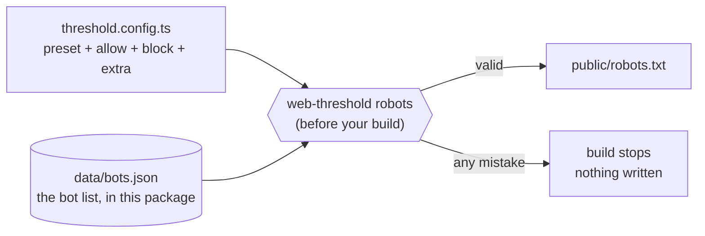

# Visitor policy: robots.txt from one config

Decide which crawlers may read your site in one small config, and let the build write `robots.txt` from it. Back to the [README](../README.md).



## Set it up

For a site with a build step. Add `threshold.config.ts` at the site's root:

```ts
import { defineThreshold } from "@ndrsc3/web-threshold/policy";

export default defineThreshold({
  bots: { preset: "block-ai-training", allow: ["CCBot"], block: ["Bytespider"] },
  extra: "User-agent: *\nDisallow: /cgi-bin/\nSitemap: https://example.com/sitemap.xml",
});
```

Run it before the build, and gitignore the output, which is rebuilt each time:

```json
"scripts": { "prebuild": "web-threshold robots" }
```

`web-threshold robots` writes `public/robots.txt`. A bad config stops the build with a non-zero exit and writes nothing, because a typo must never mean a bot silently stays unblocked. It needs a Node with type stripping (Node 24) and a site that isn't `"type": "commonjs"`.

## Presets

| Preset | Blocks | Lets through |
|---|---|---|
| `open` | nothing | everyone |
| `block-ai-training` | AI training crawlers | everyone else |
| `block-all-ai` | AI training and AI search crawlers | user-triggered fetchers, search engines, unlisted bots |
| `search-engines-only` | everyone else, including user-triggered fetchers | search engines |

- **`allow` and `block`** take names from `data/bots.json`, ignoring case, and override the preset. `bots.preset` is required.
- **`extra`** is raw robots.txt text, copied as written after the generated groups. Its rules must start with a `User-agent` line. It can't have a `User-agent: *` group under `search-engines-only`. A bot the list lacks goes here as its own group.
- **An existing `public/robots.txt`** that this tool didn't generate is left alone, and the run fails. Move any rules you need into `extra`, then `git rm` it.

## Limits

- robots.txt is a sign, not a lock. It doesn't stop bots that ignore it, or impostors.
- A site with no build step keeps a hand-written file.
- `AdsBot-Google` ignores `*`, so `search-engines-only` doesn't stop it. To block it: `extra: "User-agent: AdsBot-Google\nDisallow: /"`.
- `search-engines-only` also blocks link previews, which come from unlisted bots. To allow one: `extra: "User-agent: facebookexternalhit\nAllow: /"`.
- Removing a name from the list in a later version stops the build of a site that names it. That's deliberate; release notes say so.

## What blocking costs

From the operators' own docs, read 261102.

| Bot | What blocking it does | Source |
|---|---|---|
| `Googlebot` | Affects Google Search, Images, Video and News. A blocked URL can still be listed, without its content. | [Google](https://developers.google.com/search/docs/crawling-indexing/googlebot) |
| `Google-Extended` | Opts out of Gemini training and grounding. Not a Search signal. It never visits, so only robots.txt can express it. | [Google](https://developers.google.com/crawling/docs/crawlers-fetchers/google-common-crawlers) |
| `GPTBot` | Opts out of OpenAI training. Independent of ChatGPT search. | [OpenAI](https://developers.openai.com/api/docs/bots) |
| `OAI-SearchBot` | Drops you from ChatGPT search answers, though you can still appear as a navigational link. | [OpenAI](https://developers.openai.com/api/docs/bots) |
| `ChatGPT-User` | Aimed at a person's own request. OpenAI says robots.txt rules may not apply. | [OpenAI](https://developers.openai.com/api/docs/bots) |
| `ClaudeBot` | Opts out of collection that could contribute to Anthropic's training. | [Anthropic](https://support.claude.com/en/articles/8896518-does-anthropic-crawl-data-from-the-web-and-how-can-site-owners-block-the-crawler) |
| `Claude-SearchBot` | May reduce visibility in Claude's search results. | [Anthropic](https://support.claude.com/en/articles/8896518-does-anthropic-crawl-data-from-the-web-and-how-can-site-owners-block-the-crawler) |
| `Claude-User` | Stops Claude fetching your pages when a person asks about them. | [Anthropic](https://support.claude.com/en/articles/8896518-does-anthropic-crawl-data-from-the-web-and-how-can-site-owners-block-the-crawler) |
| `PerplexityBot` | Drops you from Perplexity's search listings. Perplexity says it isn't used for training. | [Perplexity](https://docs.perplexity.ai/guides/bots) |
| `Perplexity-User` | Aimed at a person's own request. Perplexity says it generally ignores robots.txt. | [Perplexity](https://docs.perplexity.ai/guides/bots) |
| `Applebot` | Affects search in Siri, Spotlight and Safari. | [Apple](https://support.apple.com/en-us/119829) |
| `Applebot-Extended` | Opts out of Apple's model training, and pages can still appear in search. It never crawls. | [Apple](https://support.apple.com/en-us/119829) |
| `meta-externalagent` | Opts out of Meta's training and direct product indexing. | [Meta](https://developers.facebook.com/docs/sharing/webmasters/web-crawlers) |
| `meta-externalfetcher` | Aimed at a person's own request. Meta says it may bypass robots.txt. | [Meta](https://developers.facebook.com/docs/sharing/webmasters/web-crawlers) |
| `Bingbot` | DuckDuckGo says it sources links largely from Bing, so its results are affected too. | [DuckDuckGo](https://duckduckgo.com/duckduckgo-help-pages/results/sources/) |

The bot list is hand-kept. Names and purposes were checked against [ai.robots.txt](https://github.com/ai-robots-txt/ai.robots.txt) and operators' docs; `YandexBot` and `Baiduspider` weren't checked against an operator's page.

ai.robots.txt is MIT licensed:

> MIT License. Copyright (c) 2024 ai.robots.txt. Permission is hereby granted, free of charge, to any person obtaining a copy of this software and associated documentation files (the "Software"), to deal in the Software without restriction, including without limitation the rights to use, copy, modify, merge, publish, distribute, sublicense, and/or sell copies of the Software, and to permit persons to whom the Software is furnished to do so, subject to the following conditions: The above copyright notice and this permission notice shall be included in all copies or substantial portions of the Software. THE SOFTWARE IS PROVIDED "AS IS", WITHOUT WARRANTY OF ANY KIND, EXPRESS OR IMPLIED, INCLUDING BUT NOT LIMITED TO THE WARRANTIES OF MERCHANTABILITY, FITNESS FOR A PARTICULAR PURPOSE AND NONINFRINGEMENT. IN NO EVENT SHALL THE AUTHORS OR COPYRIGHT HOLDERS BE LIABLE FOR ANY CLAIM, DAMAGES OR OTHER LIABILITY, WHETHER IN AN ACTION OF CONTRACT, TORT OR OTHERWISE, ARISING FROM, OUT OF OR IN CONNECTION WITH THE SOFTWARE OR THE USE OR OTHER DEALINGS IN THE SOFTWARE.
